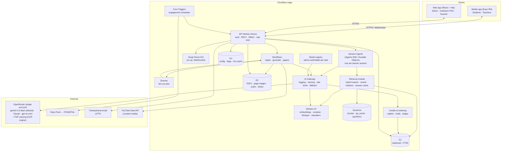
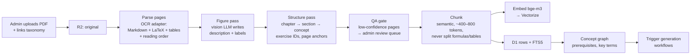
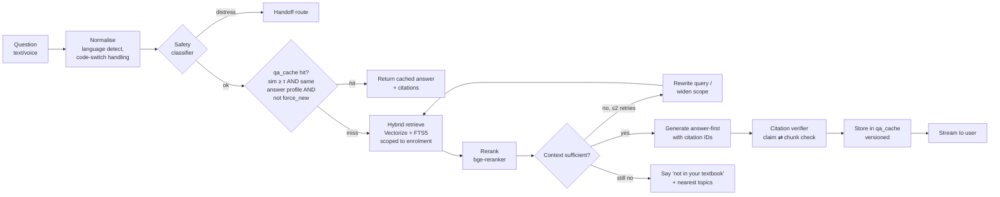
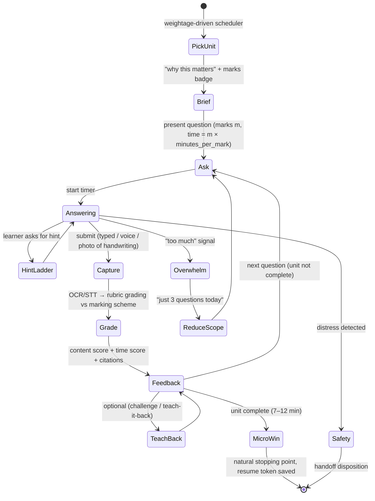
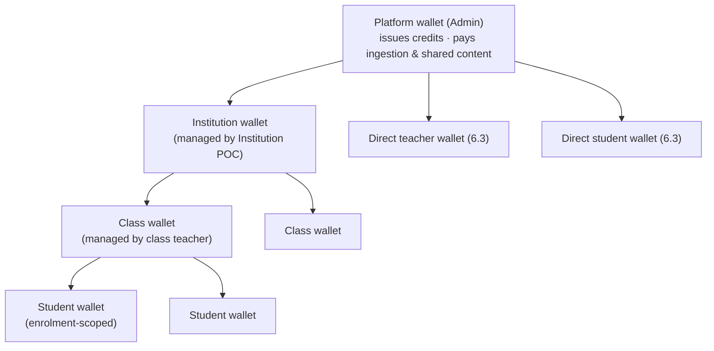
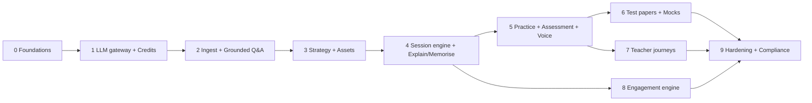

# AI Coach — Architecture Design Document

| | |
|---|---|
| **Status** | Draft v2 — includes Section 9 decisions (pilot scope, OpenRouter, credits, model switching) |
| **Date** | 2026-11-08 |
| **Source spec** | [feature_description.txt](feature_description.txt) |
| **Scope** | System architecture, AI approach decision, tech stack, phased delivery plan |

---

## 1. Summary

AI Coach is a **mobile-first, board-exam-aligned AI tutor** for Indian students and teachers. It takes in prescribed textbooks (PDF) plus exam-board guidelines and uses them to drive explanation, memorisation, practice, test-paper and lecture-preparation journeys. Every answer cites its textbook source.

Main decisions:

1. **AI approach: Agentic RAG built on explicit, deterministic state graphs.** This is a hybrid. One shared, grounded retrieval layer (hybrid search, reranking and mandatory citations) serves every journey. Each journey (practice, explanation, test paper and so on) is an **explicit state machine**, where LLM calls are nodes and the code controls the transitions. The LLM gets limited autonomy in a few places only: deciding to retrieve again, picking hint depth, and self-verifying citations. There is **no free-form multi-agent swarm**. We use the *LangGraph pattern* (graph, checkpoints, interrupts, resume) but **implement it with Cloudflare-native primitives**: Agents SDK on Durable Objects for interactive sessions, and Workflows for long pipelines. We don't adopt the LangGraph library. Section 4 gives the reasoning.
2. **Platform: Cloudflare-first.** Workers, Durable Objects, Workflows, D1, R2, Vectorize, KV, Workers AI, AI Gateway, Queues and Cron Triggers. External services are added only where Cloudflare has no good equivalent: LLMs, push delivery and email.
3. **All LLM calls go through one OpenRouter account.** This covers chat, generation, grading, vision, PDF OCR and speech. The **model is chosen per task by the Admin** at runtime. The default is `google/gemini-2.5-flash`; the alternatives are Claude Sonnet 5.5, Claude Haiku 5.5 and `openai/gpt-4o-mini` (§6.5).
4. **Prepaid credit system.** Credits are bought offline. Admin issues them, and they flow **Admin → Institution → Class (teacher) → Student**, or directly to a teacher or student. Balances are in **rupees**. Every LLM call is charged at **OpenRouter's actual cost, converted to INR, + a platform fee** (10% by default; the fee is visible only to Admin). Each role sees its own usage and its immediate downline; Admin sees the full tree (§6.6).
5. **Clients:** an **Expo (React Native)** mobile app for students and teachers, and a **React + Vite** web app with **Admin, Institution POC and Teacher areas**, served from Workers static assets.
6. **Cost strategy:** *Generate once, serve many.* The expensive content (notes per marks weightage, memory maps, question banks) is generated **at ingest time** and stored. Interactive questions first go through a **semantic answer cache** (spec 1.3), which the user can bypass with "force new answer" (spec 1.4). This keeps LLM spend and free-tier usage under control.
7. **Delivery:** **10 phases (0–9)**, each producing a working, testable vertical slice. Credits and metering come in Phase 1, before any learner-facing LLM feature. The attention/engagement design (spec 5, flagged as the top priority) is **built into every phase** as a set of design rules. It is not a late add-on.
8. **Pilot scope:** **Karnataka 2nd PUC Accountancy** (KSEAB), **English only**, **NCERT textbooks**, with distress handoff routed to the **parent**.

---

## 2. Requirements distilled

### 2.1 Functional areas → architectural consequences

| Spec | Requirement | Architectural consequence |
|---|---|---|
| 1.1–1.2 | PDFs with images, formulae, tables, multi-column layouts | Need a **layout-aware, vision-capable parser** that outputs Markdown + LaTeX + table structure + figure descriptions with page anchors. Plain text extraction is not enough. |
| 1.3–1.4 | Reuse answers to similar questions; force-new option | **Semantic answer cache** (vector similarity + answer-profile key), versioned answers, and a bypass flag. |
| 2.1–2.5, 3.x | Many distinct journeys with timing, pause/resume and assessment | **Stateful, resumable session engine.** Each journey is a state graph with persisted checkpoints. |
| 2.2.1, 2.3.3 | Writing speed and time management | Timed attempts, **handwritten answer capture** (photo → OCR → grading), and a minutes-per-mark model taken from the board blueprint. |
| 2.3.1, 5.5.13 | Text + voice input; English/Hindi/Kannada code-switching | **Launch is English only.** Keep the design multilingual-ready (multilingual embeddings, language field on content and answer profiles) so Hindi/Kannada can be added without re-architecture. |
| 2.5 | Past papers + predicted papers per board guidelines | Admin-curated PYQ collection, blueprint extraction, a constraint-based paper assembler, and *honest* labelling. |
| 4.1–4.2 | Email/password, 2FA on by default, Student/Teacher/**Institution POC**/Admin roles, multi-enrolment | Auth service with email-OTP/TOTP 2FA and RBAC scoped to enrolments (institution × board × class × subject). Institution POC role added for credit distribution. |
| 4.3 | PDF is linked to board/class/subject/institution; guidelines shape all journeys | **Curriculum taxonomy** as the core of the data model. Board guidelines are processed into **strategy documents** that every journey reads. |
| 5.x | Attention, notifications, in-app media, GenZ/GenAlpha traits | An **engagement engine** (scheduler, notification policy, media curation, introspection prompts) plus cross-cutting UX rules (answer-first, 7–12 min units, no dark patterns). |
| 5.5.3 | Cite the textbook location for every claim | **Citations are mandatory output** of the retrieval layer, with a post-generation **citation verifier** and uncertainty flagging. |
| 5.5.7 | Route distress to a safety handoff | A **safety classifier** on every learner turn, with a deterministic handoff route that bypasses the LLM. |
| 6.2 | Use as much of the Cloudflare free tier as possible | Cloudflare-native architecture with explicit free-tier budgets (§6.4). |
| Dec. 6 | One OpenRouter account; admin-switchable models | Single **LLM router** with a **model registry** (per task, capability-aware, fallback chain), configurable at runtime (§6.5). |
| Dec. 6.1–6.4 | Offline payments → credits; hierarchical distribution; charge = OpenRouter cost + 10% | **Wallet tree + double-entry ledger**, hold-and-settle metering on every LLM call, offline payment records (§6.6). |
| Dec. 6.5 | Usage visible to self + immediate downline; Admin sees all | Usage roll-ups per wallet node, enforced by **downline-scoped authorisation** (§6.6). |
| Dec. 4–5 | Distress handoff to parent; teacher area on web | Parent contact + consent captured at onboarding. The web app has role areas for Admin, Institution POC and Teacher. |

### 2.2 Non-functional requirements

| Concern | Target |
|---|---|
| Time-to-first-token (interactive tutoring) | < 1.5 s at p50 (answer-first, streamed) |
| Cached answer latency | < 300 ms |
| Device/network | Mid-range Android, patchy 3G/4G, offline packs (5.5.6) |
| Grounding | 100% of factual claims carry a citation or an explicit "not in your textbook" flag |
| Privacy | India **DPDP Act 2023**: verifiable parental consent for minors, no behavioural tracking or targeted ads to children, data minimisation. Declared interests over inferred ones (5.5.11). |
| Security | 2FA by default, RBAC, tenant isolation per institution, encrypted secrets, audit log for admin actions |
| Testability | Every phase ships with automated tests **and** an LLM evaluation suite (golden sets) that runs in CI |

---

## 3. System architecture

### 3.1 High-level view



### 3.2 Components

| # | Component | Runtime | Responsibility |
|---|---|---|---|
| 1 | **Mobile app** | Expo / React Native | Student and teacher journeys, voice capture, camera (handwritten answers), offline packs, push notifications, vertical-first UI |
| 2 | **Web app** | React + Vite on Workers static assets | **Admin area:** taxonomy, PDF upload and parse review, guidelines, PYQ curation, media allow-list, users/roles, model switching, payments & credit issuance, full usage tree. **Institution POC area:** classes, teachers, credit allocation to classes, class-level usage. **Teacher area:** lecture prep, cohort dashboards, credit allocation to students, student-level usage |
| 3 | **API Worker** | Hono on Workers | AuthN/AuthZ, REST endpoints, request validation (Zod), rate limiting, routes interactive sessions to Session Agents |
| 4 | **Session Agent** | Agents SDK (Durable Object, SQLite storage) | One instance per active learner session. Runs the journey **state graph**, keeps checkpoints, timers (alarms), WebSocket streaming, pause/resume (2.3.2) |
| 5 | **Study Room** | Durable Object + WebSocket hibernation | Co-op study rooms, peer-explain pairing (5.5.8–5.5.9) |
| 6 | **Ingestion Workflow** | Cloudflare Workflows | Durable, retryable multi-step PDF → knowledge pipeline (§3.4) |
| 7 | **Generation Workflows** | Workflows + Queues | Pre-generate notes, memory maps, question banks, strategies and predicted papers. Fan-out per chapter/concept |
| 8 | **Retrieval module** | TS library used by 4 and 7 | Hybrid search (Vectorize + D1 FTS5), rerank, citation packaging, semantic answer cache |
| 9 | **LLM router** | TS library → AI Gateway → OpenRouter | Resolves the model per task from the **model registry**, applies prompt templates, structured output (JSON schema + Zod validation), retries/fallback chain, token budgets. **Every call is wrapped by the metering module.** |
| 10 | **Engagement engine** | Cron Triggers + DO alarms + Queues | Notification planning and policy, media curation, introspection prompts, re-entry deep links |
| 11 | **Safety layer** | Workers AI classifier + rules | Distress/self-harm detection → **parent handoff** + helpline shown to the student. Abuse/PII filtering. Age-appropriate content guard |
| 12 | **Model registry** | D1 table, cached in KV | Per-task model choice, capability flags (text/vision/audio/pdf), prices synced from OpenRouter, fallback chain, change audit (§6.5) |
| 13 | **Credits & metering** | TS module + D1 | Wallet tree, offline payments, issuance/allocation, consent-based corrections & mutual lock, hold → settle per LLM call, usage records, roll-ups, downline-scoped reporting (§6.6) |

### 3.3 Data stores

| Store | What lives there | Why |
|---|---|---|
| **D1** (SQLite) | Users, roles, enrolments, taxonomy, books/chapters/pages/chunks metadata, questions, attempts, mastery, cards, notifications, consent, audit, **wallets, ledger, payments, LLM usage, model registry**. **FTS5** index over chunk text | Relational integrity plus free keyword search (needed for formula symbols, terms and exercise numbers that embeddings handle poorly) |
| **R2** | Original PDFs, per-page images, extracted figures, parsed Markdown, audio clips, handwritten-answer photos, generated decks/exports, offline packs | Zero egress fees, cheap bulk storage |
| **Vectorize** | `chunks` index (textbook content), `qa_cache` index (question embeddings → cached answers), `questions` index (question-bank dedup/similarity) | Semantic retrieval. Metadata filters on `book_id`, `chapter_id`, `board_id`, `lang` |
| **KV** | Feature flags, prompt versions, model routing config, hot read-mostly caches (e.g. compiled strategy docs) | Global low-latency reads |
| **Durable Object storage** | Live session state and checkpoints, timers, room state | Strong consistency per session. Survives disconnects, which enables one-tap resume |

### 3.4 Textbook ingestion pipeline (spec 1.1–1.2, 4.3)



Design notes:

- **Parser adapter interface** (`parsePdf(pdf) → Page[]`), run **through OpenRouter** so ingestion uses the same account and metering. The default is OpenRouter's PDF parsing with its OCR engine (e.g. `mistral-ocr`), which returns per-page Markdown with tables, formulas and correct reading order for multi-column layouts. A vision model chosen in the registry (task `figure_description` / `pdf_page_fallback`, default gemini-2.5-flash) handles **hard pages** and figures. Ingestion is charged to the **platform wallet** (§6.6). Check the exact OpenRouter PDF-plugin options when building Phase 2.
- **Accountancy-specific (pilot):** the NCERT Accountancy books are mostly **tables**: journal entries, ledger/T-accounts, partners' capital accounts, balance sheets, cash-flow statements, ratio computations. The parser must keep table structure (rows, Dr/Cr columns, totals) as HTML/Markdown tables. The fixture suite must include these formats, and chunking must never split a table or a worked illustration from its solution.
- **Every chunk carries a citation anchor**: `{board, book, edition, chapter, section, page_start, page_end, exercise_id?, figure_id?}`. This is what makes 5.5.3 (textbook citation grounding) possible.
- **Formulas are stored as LaTeX** and rendered on the client with KaTeX. Tables are stored as Markdown/HTML. Figures are stored as R2 images plus descriptions, so retrieval can match a figure through its description.
- **QA gate:** pages with low OCR confidence, an odd reading order or a parse error go to an **admin review screen** showing a side-by-side view of the page image and the parsed text. This is the main quality-control lever.
- **Idempotent, durable steps** (Workflows). A 400-page book can be resumed from the failed step instead of restarting.

### 3.5 Board guidelines → strategy layer (spec 4.3.1.1–4.3.1.2)

Guidelines (syllabus, blueprint or "design of question paper", marking scheme samples, typology of questions) are ingested through the same pipeline and then **compiled into a structured `ExamStrategy` document** per board × class × subject:

```jsonc
// Illustrative shape. All values are compiled from the official KSEAB
// 2nd PUC Accountancy blueprint/model papers, never hard-coded.
{
  "board": "KSEAB", "class": "2nd PUC", "subject": "Accountancy", "year": 2027,
  "duration_min": "<from blueprint>", "max_marks": "<theory marks>",
  "sections": [{ "name": "A", "type": "<MCQ/fill-in>", "marks_each": 1, "count": "<n>" }, ...],
  "unit_weightage": [{ "unit": "Partnership – admission", "marks": "<n>" }, ...],
  "typology": { "knowledge": 0.0, "understanding": 0.0, "application": 0.0, "skill": 0.0 },
  "answer_conventions": {
    "journal_entry": "date · particulars · L.F. · Dr · Cr · narration",
    "ledger": "T-account, balance c/d and b/d",
    "long_problem": "working notes shown separately"
  },
  "minutes_per_mark": "<duration / marks>",
  "source_citations": [ ... ]
}
```

Every journey reads this object. It drives notes length per marks weightage (2.1.1), time targets (2.3.3), the weightage-driven scheduler (5.5.14), marks badges (5.5.12) and paper blueprints (2.5.2). Admins review it before publishing. Because it is **data, not prompts**, it can be tested and versioned.

### 3.6 Retrieval and grounded answering



**Semantic answer cache (1.3–1.4):**

- **Key:** `embedding(normalised question)` plus an **answer profile** `{book_version, journey, marks_weightage, language, depth_level}`. A cached 2-mark answer must never be returned for a 5-mark request.
- **Hit rule:** cosine ≥ τ (start at 0.92 and tune on the eval set) **and** an exact profile match. Optionally, a cheap LLM "same question?" check in the grey zone (0.88–0.92).
- **Force new (1.4):** bypasses the cache and generates a new **variant** that is stored next to the original. Users can rate variants, and the best-rated one becomes the default.
- **Invalidation:** the cache is keyed by `book_version` and `prompt_version`, so re-ingestion or a prompt change retires stale entries automatically.
- **Second layer:** AI Gateway exact-match caching for identical LLM requests.
- **Billing:** a cache hit (semantic or gateway) costs **0 credits**, because OpenRouter charged nothing. "Force new answer" is a real LLM call and is charged normally, and the UI says so before the user confirms. On a gateway cache hit the cached body still contains the original `usage.cost`, so the metering module must check the gateway cache-status header and **not** charge.

**Grounding guarantees (5.5.3):** the generation prompt receives chunks with IDs and must emit `[[c:<chunk_id>]]` markers. The **verifier** (a small, cheap model) checks each claim–citation pair. An unsupported claim is either removed or tagged ⚠ *uncertain*. The client turns citation markers into tappable badges such as "Ch 3 · p. 87 · Ex 3.2", plus a **syllabus scope badge** (in syllabus / beyond syllabus).

### 3.7 Session engine: journeys as state graphs

Each journey is a **typed state graph** that runs inside a Session Agent (Durable Object). The graph definition is plain TypeScript (nodes = steps, edges = guarded transitions), which can be unit-tested without an LLM. The DO persists a checkpoint after every node, so a learner can **stop at any logical point and resume** (2.3.2) on any device.

Example: **Practice & self-assessment journey (2.3)**



Other graphs follow the same shape: Explanation (answer-first → layered depth → Socratic check → card creation), Memorisation (spaced recall → mnemonic co-creation → timed write-out), Mock Exam (blueprint paper → timed sections → batch grading → report), and Teacher Lecture Prep (plan → deck → notes → activities → drills).

### 3.8 Where the "agentic" part is, and where it isn't

| Step | Mode | Why |
|---|---|---|
| Journey control flow, timers, scoring, scheduling | **Deterministic code** | Must be testable, predictable and honest (5.5.4). No LLM decides the learner's path on its own. |
| Query rewrite / re-retrieve when context is insufficient | **Agentic (bounded, ≤ 2 loops)** | Textbook questions are often under-specified, and one rewrite noticeably improves recall |
| Hint ladder depth, Socratic follow-ups, challenge mode | **Agentic within a node** | Needs judgement about the learner's answer |
| Tool use: calculator / LaTeX check / unit conversion for maths & physics | **Agentic (tools)** | Reduces arithmetic hallucination in "show working" (5.5.1) |
| Grading | **Specialised role: Grader** with rubric + marking scheme; second-pass **Verifier** on low-confidence grades | Separating the generator from the checker is the useful part of "multi-agent" |
| Content pre-generation (notes, cards, papers) | **Workflow** with **Generator → Critic → Fixer** steps | Quality comes from structured critique, not agents talking to each other |

---

## 4. Decision: RAG vs Agentic RAG vs Multi-Agent vs LangGraph

### 4.1 What each option actually is

These four options are not all the same kind of thing:

- **RAG** is a *retrieval pattern*: retrieve, then generate, once.
- **Agentic RAG** is a *retrieval pattern with a control loop*: the model can decide to retrieve again, call tools or verify before answering.
- **Multi-agent system** is an *organisation pattern*: several LLM "agents" with roles that communicate or delegate.
- **LangGraph** is a *framework* (Python/JS) for building stateful graphs of LLM steps with checkpoints, interrupts and resume. It can implement any of the three above.

So the real questions are: (a) how much autonomy the LLM should have, and (b) what should implement the orchestration.

### 4.2 Evaluation against this app's needs

| Need | Plain RAG | Agentic RAG | Free-form Multi-Agent | Explicit state graph (LangGraph-style) |
|---|---|---|---|---|
| Grounded answers with citations (5.5.3) | ✅ core strength | ✅ better recall via re-retrieval + verify | ⚠ harder to trace which agent said what | ✅ (uses RAG inside nodes) |
| Long, stateful journeys with timers, pause/resume (2.3.2) | ❌ stateless | ❌ by itself | ⚠ state scattered across agents | ✅ **core strength** |
| Predictable, honest behaviour; no dark patterns (5.5.4) | ✅ | ✅ | ❌ emergent behaviour | ✅ transitions are code |
| Answer-first latency on mid-range phones (5.5.2) | ✅ fastest | ✅ if loops are bounded | ❌ several LLM hops per turn | ✅ |
| Cost on a free/low tier | ✅ | ✅ (bounded) | ❌ 3–10× tokens | ✅ |
| Testability (CI, golden sets) | ✅ | ✅ | ❌ non-deterministic | ✅ nodes unit-testable |
| Multi-step content generation (papers from blueprint + PYQs + chapters) | ❌ | ⚠ | ✅ | ✅ as a workflow |
| Grading with independent checking | ❌ | ⚠ | ✅ role separation | ✅ separate Grader/Verifier nodes |

### 4.3 Decision

> **Agentic RAG, orchestrated as explicit state graphs, using role-separated LLM nodes (Generator / Grader / Verifier / Critic) where they add quality. No free-form multi-agent system. The graph pattern is implemented with Cloudflare Agents SDK (Durable Objects) + Workflows instead of the LangGraph library.**

**Reasoning:**

1. **The product is mostly journeys, not single Q&A.** Practice, memorisation and mock exams are multi-turn, timed and resumable. That is a **state machine with persistence**. Plain RAG has no state model, and Agentic RAG on its own only improves a single answer. We need the graph.
2. **Grounding is the most important trust feature.** The spec calls textbook citations "the highest-leverage trust feature in the whole app". That requires a **strong retrieval layer with verification**, which is Agentic RAG (bounded re-retrieval plus a citation verifier). Plain RAG with no self-check leaks hallucinations, and the target users "correctly" assume an ungrounded tutor is hallucinating.
3. **Free-form multi-agent systems conflict with three explicit requirements:** answer-first speed (5.5.2), no manipulative or unpredictable behaviour (5.5.4), and Cloudflare free-tier economics (6.2). They multiply tokens and latency, and their behaviour emerges from agent conversation, which is hard to audit and test. We **keep the one valuable idea** (separate generator from checker) by using **role nodes inside a deterministic graph**.
4. **LangGraph is the right mental model but the wrong runtime here.** LangGraph's strengths (graph, checkpointing, human-in-the-loop interrupts, resume) are exactly what we need. However:
   - Its persistence assumes Postgres/SQLite/Redis checkpointers and a long-running Node/Python server. On Cloudflare, **Durable Objects already give us a per-session actor with transactional SQLite storage, alarms (timers) and WebSockets**. That is a native checkpointer, scheduler and transport in one.
   - **Workflows** gives durable, retryable, multi-step pipelines (ingestion, paper generation) with automatic step checkpointing.
   - Adding LangGraph.js on Workers adds bundle size and Node-compat friction for little extra value.
   - **Escape hatch:** the graph definitions are plain TypeScript with a small interface (`Node`, `Edge`, `State`). If we later move heavy AI work to a Python service (e.g. on Cloudflare Containers), porting the graphs to LangGraph is mechanical.
5. **It fits admin-switchable models.** Nodes ask the router for a *task* (`tutor_chat`, `grading`…), never for a specific model. Because control flow lives in code and not in one model's agentic habits, switching from Gemini to Claude or GPT changes answer quality, which the eval suite measures. It does not change journey behaviour. A multi-agent design depends much more on each model's tool-calling quirks and would break more easily on a switch.

### 4.4 When to revisit

- If teachers ask for **open-ended autonomous tasks** (e.g. "build me a full 6-week unit plan with resources from the web"), add a bounded **planner–executor agent** for that feature only, inside a Workflow.
- If the Python AI ecosystem becomes necessary (custom OCR models, fine-tuned graders), move the AI service to Containers/Python and adopt LangGraph there.

---

## 5. Tech stack

### 5.1 Stack overview

| Layer | Choice | Rationale |
|---|---|---|
| **Language** | TypeScript everywhere | One language across mobile, web, edge and shared domain types |
| **Monorepo** | pnpm workspaces + Turborepo | Shared `core`/`db`/`rag` packages, cached builds |
| **Mobile** | **Expo (React Native)**, Expo Router, TanStack Query, Zustand, expo-sqlite (offline), expo-audio, expo-camera, expo-notifications, KaTeX via `react-native-math-view`/WebView | Android-first reach, OTA updates, push, offline. One codebase for Android + iOS |
| **Web app (Admin / Institution POC / Teacher)** | **React + Vite**, TanStack Router/Query, shadcn/ui + Tailwind, hosted as **Workers static assets** | Fast SPA, free hosting, same Worker routing. Role-based areas |
| **API** | **Hono** on Cloudflare Workers, Zod validation, OpenAPI generation | Lightweight, edge-native, typed |
| **Auth** | **Better Auth** (D1 adapter) with email+password, **email OTP 2FA on by default**, optional TOTP, RBAC plugin. Turnstile on sign-up/login | Spec 4.1. Self-hosted on Workers, no per-MAU fees |
| **ORM / migrations** | **Drizzle ORM** + drizzle-kit → D1 | Type-safe SQL, D1-native |
| **Sessions / agents** | **Cloudflare Agents SDK** (Durable Objects, SQLite storage, alarms, WebSocket hibernation) | Stateful journey graphs, resume, timers, streaming |
| **Pipelines** | **Cloudflare Workflows** + **Queues** | Durable ingestion and generation |
| **Scheduling** | **Cron Triggers** + DO alarms | Engagement scheduler, nightly jobs |
| **Relational DB** | **D1** (+ FTS5) | Free tier, SQLite, keyword search |
| **Vectors** | **Vectorize** | Native, metadata filtering |
| **Objects** | **R2** | PDFs, images, audio, exports. Zero egress |
| **Config/cache** | **KV** | Flags, prompt registry |
| **LLM provider** | **OpenRouter** (one account, OpenAI-compatible API) | Single bill and key, many models, per-request actual cost in the response (`usage.cost`) for exact metering |
| **LLM models** (admin-switchable per task, §6.5) | **Default `google/gemini-2.5-flash`**. Options: Claude Sonnet 5.5, Claude Haiku 5.5, `openai/gpt-4o-mini` | Flash: low cost, vision + audio + long context. Sonnet for quality-critical generation/grading if needed. Haiku / gpt-4o-mini as cheap text alternatives |
| **LLM gateway** | **Cloudflare AI Gateway** in front of OpenRouter | Free logging, caching, rate limiting, analytics. OpenRouter is a supported gateway provider |
| **Embeddings** | Workers AI **`@cf/baai/bge-m3`** (multilingual, 1024-d) | Handles English/Hindi/Kannada and code-mixed text. Runs on Cloudflare |
| **Reranker** | Workers AI **`@cf/baai/bge-reranker-base`** | Better precision before generation |
| **STT** | Audio-capable model via OpenRouter (default gemini-2.5-flash, metered). Fallback: Workers AI **Whisper (large-v3-turbo)** when the selected model lacks audio input | Voice input (2.3.1). English at launch |
| **TTS (optional)** | Device TTS | Text response is the default per spec. Audio is optional |
| **PDF parsing / OCR** | OpenRouter PDF parsing (OCR engine) behind a parser adapter. Vision-model fallback for hard pages and figures | Multi-column, tables, formulas (1.1–1.2). Accountancy tables |
| **Handwriting OCR** | Vision model via OpenRouter (task `vision_ocr`) | Grading photographed answers for writing speed and content |
| **Not metered to users** | Workers AI embeddings, reranker, safety classifier | Low-cost infrastructure covered by the 10% platform fee |
| **Slides export (teachers)** | Generate a structured deck JSON → render in-app. Export to `.pptx` with `pptxgenjs` | Spec 3.2.1 |
| **Push** | Expo Push Service → FCM/APNs | Free, simple |
| **Email (OTP, digests, parent alerts)** | Resend (free tier) or Cloudflare Email Service when available on the account, behind a **`Notifier` channel interface** (`email` and `push` now; `whatsapp` and `sms` adapters can be added later without changing callers) | 2FA codes, parent digest, safety alerts (decision 9.2-5) |
| **Media** | YouTube Data API v3 + IFrame player (curated channel allow-list) | 5.3: allowed embedding, captions |
| **Observability** | Workers Logs + Analytics Engine, AI Gateway analytics, Sentry (mobile & web) | Free tiers |
| **Testing** | Vitest + `@cloudflare/vitest-pool-workers`, Playwright (admin web), Maestro (mobile E2E), custom **eval harness** (golden sets, LLM-as-judge) | Progressive, CI-gated |
| **CI/CD** | GitHub Actions → Wrangler deploy (preview/staging/prod environments), EAS Build for mobile | |

### 5.2 Monorepo layout

```
aicoach/
├─ apps/
│  ├─ mobile/          Expo app (students, teachers)
│  ├─ admin-web/       React + Vite admin dashboard
│  └─ worker/          Single Cloudflare Worker: Hono API + DO classes + Workflows
│     ├─ src/api/        routes (auth, taxonomy, books, journeys, admin…)
│     ├─ src/agents/     SessionAgent, StudyRoom (Durable Objects)
│     ├─ src/workflows/  IngestBook, CompileStrategy, GenerateAssets, BuildPaper
│     └─ src/cron/       engagement scheduler
├─ packages/
│  ├─ core/            domain types, Zod schemas, journey graph engine
│  ├─ db/              Drizzle schema + migrations
│  ├─ rag/             retrieval, rerank, citation verifier, answer cache
│  ├─ llm/             model router, prompt registry, structured-output helpers
│  ├─ journeys/        graph definitions per journey (pure TS, unit-tested)
│  └─ ui-tokens/       shared design tokens (colours, type scale)
├─ evals/              golden sets, judge rubrics, runner
└─ docs/
```

### 5.3 Core data model (abridged)

```mermaid
erDiagram
  INSTITUTION ||--o{ ENROLMENT : has
  BOARD ||--o{ SUBJECT_OFFERING : defines
  CLASS ||--o{ SUBJECT_OFFERING : has
  SUBJECT ||--o{ SUBJECT_OFFERING : in
  SUBJECT_OFFERING ||--o{ BOOK : prescribes
  SUBJECT_OFFERING ||--o{ EXAM_STRATEGY : governed_by
  USER ||--o{ ENROLMENT : "student/teacher in"
  ENROLMENT }o--|| SUBJECT_OFFERING : for
  BOOK ||--o{ CHAPTER : contains
  CHAPTER ||--o{ CONCEPT : covers
  CHAPTER ||--o{ CHUNK : split_into
  CHUNK }o--|| PAGE : anchored_to
  CONCEPT ||--o{ GENERATED_ASSET : "notes/cards/maps"
  CONCEPT ||--o{ QUESTION : assessed_by
  QUESTION }o--o| PAPER : appears_in
  USER ||--o{ SESSION : runs
  SESSION ||--o{ ATTEMPT : records
  ATTEMPT }o--|| QUESTION : answers
  USER ||--o{ MASTERY : "per concept"
  USER ||--o{ LEARNER_ARTEFACT : "cards/mnemonics"
  USER ||--o{ INTEREST : declares
  QA_CACHE }o--|| BOOK : scoped_to
```

Key tables: `users`, `two_factor`, `roles`, `institutions`, `boards`, `classes`, `subjects`, `subject_offerings`, `enrolments`, `books`, `book_versions`, `chapters`, `concepts`, `pages`, `chunks`, `figures`, `exam_strategies`, `generated_assets(type, scope, marks, lang, version)`, `questions(source: textbook|pyq|generated|predicted, marks, typology)`, `papers`, `qa_cache`, `qa_variants`, `sessions`, `attempts`, `grades`, `mastery`, `learner_artefacts`, `interests`, `notifications`, `media_items`, `consents`, `audit_log`, `class_groups` (class within an institution, with class teacher), `parent_contacts`, `model_registry`, `institution_books`, `wallets`, `allotments` (status open/locked, corrections), `ledger_entries`, `credit_holds`, `payments` (type credit_purchase / onboarding_fee), `llm_usage`, `usage_rollups_daily`, `notification_channels`.

---

## 6. Cross-cutting concerns

### 6.1 Attention & engagement (spec 5, top priority) as design rules

Attention is an **architecture-wide rule set**, enforced through the session engine, the notification policy and UI review. It is not a single module.

| Trait (spec id) | Enforced by |
|---|---|
| ai_as_collaborator | Every explanation node supports *challenge*, *teach-it-back* and *show working* transitions |
| utility_seeking | Responses are generated **answer-first** (first sentence = direct answer). Depth is behind one tap. One-tap resume from the home screen |
| verification_reflex | Mandatory citations, verifier, ⚠ uncertainty flags, syllabus-scope badge |
| anti_manipulation_detection | **Notification policy rules in code** (no loss framing, no fake urgency, frequency caps, quiet hours). Progress model shows honest numbers. Streaks show only "days studied", with no "you'll lose it" messages |
| short_session_high_intensity | Journey graphs are built from **7–12 min units** that always end at a `MicroWin` node |
| mobile_video_first | Vertical-first UI, captions on, offline packs, low-bandwidth mode (text-only, compressed images) |
| emotional_bandwidth_management | `Overwhelm` → `ReduceScope` transitions in every graph. Safety classifier → **parent handoff** (plus helpline such as Tele-MANAS 14416 shown immediately to the student), **never** an LLM pep talk |
| gaming_native | Mastery-gated chapters, "chapter boss" sets, retry without penalty. **No** loot boxes, variable rewards or daily-login pressure |
| coop_over_competition | Study rooms (DO), peer-explain pairing, **private progress only** (no public leaderboards) |
| creator_identity | Learner-authored cards, mnemonic co-creation, artefact locker, shareable summary cards |
| many_persistent_interests | **Declared** interest profile → interest-anchored analogies and word problems (prompt context) |
| purpose_orientation | Every concept shows **two "why" badges**: exam utility (marks, PYQ frequency) and real-world hook |
| multilingual_code_switching | **English at launch.** Casual Hinglish/Kanglish input is tolerated and answered in English. Full Hindi/Kannada explanations are deferred, but the data model and embeddings are ready for them |
| board_exam_centrality | Weightage-driven scheduler, marking-scheme feedback, marks prediction |
| institutional_context | Teacher cohort dashboard, misconception roll-up, parent digest |

**Distraction countermeasures (5.1–5.3):**

- **Notifications that bring learners back** are content-led and honest, e.g. *"Your mnemonic for Lenz's law — can you still recall it? (2 min)"*. They're scheduled inside learner-declared study windows, with adaptive frequency (back off if ignored).
- **Focus mode:** on Android, the app can request *Do Not Disturb access* and silence other apps during a session, with explicit consent. iOS doesn't allow this without the Screen Time / FamilyControls entitlement, so on iOS we offer guided Focus setup. Feasibility is checked in Phase 8.
- **In-app curated media (5.3):** YouTube videos from an **admin-approved channel allow-list**, matched to the learner's current or upcoming chapters. When playback ends, an **introspection question** linked to the chapter opens with a deep link into the right journey node. Other social platforms restrict in-app embedding and content APIs, so they are out of scope for v1.

### 6.2 Safety, privacy, compliance

- **DPDP Act 2023:** verifiable parental consent flow for users under 18, a consent ledger, no behavioural ad targeting, data minimisation, deletion/export on request. The institution-first B2B2C model is how we use the educational-institution exemption (5.5.15). **Legal review required.**
- **Safety handoff → parent (decision 4):** classifier on every learner turn. Distress bypasses the LLM. The student immediately gets a fixed, caring response with helpline numbers, and the **registered parent contact** gets a short, non-alarming alert by email (SMS later). The student is told at onboarding that this happens, and parent contact + consent are **mandatory at sign-up for minors** (this also covers DPDP parental consent). If no parent contact is verified, the alert goes to the institution POC. Every trigger is logged for audit. Message text is **reviewed by a counsellor** before launch.
- **Content rights:** textbooks are uploaded by institutions/admins under their own licence. Content stays tenant-scoped. For **PYQ papers (2.5.1)**, use **admin-curated sources** (board websites that publish papers publicly), fetched with Browser Rendering or uploaded manually, and respect site terms and robots.txt. Don't scrape the open web indiscriminately.
- **Predicted papers (2.5.2)** are always labelled *"Practice paper modelled on the official blueprint and past-paper patterns"*, never "leaked" or "guaranteed". This also follows from the anti-manipulation trait.

### 6.3 Testing & evaluation strategy

| Layer | Tooling | Gate |
|---|---|---|
| Domain logic, journey graphs | Vitest (pure TS, LLM mocked) | 100% transition coverage per graph |
| Workers / DO / D1 integration | `@cloudflare/vitest-pool-workers` (Miniflare) | Per PR |
| API contract | OpenAPI schema tests | Per PR |
| Admin web E2E | Playwright | Per PR |
| Mobile E2E | Maestro flows on an Android emulator | Nightly |
| **LLM quality** | `evals/` harness: golden Q&A per book, citation accuracy, grading agreement with teacher-marked answers, notes rubric (LLM-as-judge + sampled human review) | Per PR touching prompts/RAG. Regression thresholds block merge |
| Parsing quality | Fixture PDFs (2-column, formula-heavy, table-heavy, scanned) with expected Markdown snapshots | Per PR touching ingestion |

### 6.4 Cloudflare free tier: where it fits and where it doesn't

*Limits change often. Verify against Cloudflare's pricing pages before committing. The numbers below are approximate and only show the shape of the constraints.*

| Product | Free tier (approx.) | Fit for AI Coach |
|---|---|---|
| Workers | 100k requests/day, **~10 ms CPU per request** | ✅ for I/O-bound API calls (waiting on LLM/DB doesn't count as CPU). ⚠ CPU-heavy work (password hashing, PDF handling, large JSON) can hit 10 ms |
| Durable Objects (SQLite) | Available on the free plan with daily request/duration limits | ✅ pilot scale |
| Workflows | Available on the free plan, with limits | ✅ pilot scale |
| D1 | ~5 GB total, millions of row reads/day, ~100k row writes/day | ✅ pilot |
| R2 | 10 GB storage, zero egress | ✅ ~dozens of books + images |
| **Vectorize** | **~5M stored vector dimensions** | ⚠ With 1024-d embeddings that's only **~5k chunks ≈ 3–4 textbooks**. Fine for development, tight for a pilot |
| Workers AI | ~10k Neurons/day | ✅ embeddings/STT in dev. ⚠ Bulk ingestion embeddings may need several days or the paid plan |
| KV | 100k reads/day, 1k writes/day | ✅ config only (keep writes out of KV) |
| AI Gateway | Free core features | ✅ |
| Queues | Check current plan availability and limits | ⚠ Design so Workflows can work without Queues |

**Recommendation:** build and test Phases 0–4 entirely on the **free plan**. Move to **Workers Paid (~US$5/month)** before the first institutional pilot. That removes the 10 ms CPU ceiling and adds much larger Vectorize, Workers AI, DO and Queues allowances. In practice, the main costs are **OpenRouter usage**, not Cloudflare. Users pay for it through credits, and it is kept down by pre-generation, the semantic cache and the low-cost Flash default.

### 6.5 LLM provider & admin model switching (decision 6)

**One provider account.** All generative and understanding calls (chat, generation, grading, vision, PDF parsing, audio) go to **OpenRouter** through Cloudflare AI Gateway, using one API key stored as a Worker secret. Only the Workers AI infrastructure calls (embeddings, reranker, safety classifier) stay on Cloudflare. They are cheap, they aren't charged to users, and changing the embedding model would require re-indexing everything, so it isn't switchable.

**Tasks, not models.** Code always asks the router for a task. The admin decides which model serves each task:

| Task | Needs | Default |
|---|---|---|
| `tutor_chat` (explain, Socratic, hints) | text, streaming | `google/gemini-2.5-flash` |
| `query_rewrite`, `citation_verify` | text, JSON | `google/gemini-2.5-flash` |
| `content_generation` (notes, cards, question bank, decks) | text, JSON, long output | `google/gemini-2.5-flash` |
| `grading` (rubric / marking scheme) | text + vision, JSON | `google/gemini-2.5-flash` |
| `vision_ocr` (handwritten answers) | vision | `google/gemini-2.5-flash` |
| `figure_description`, `pdf_page_fallback` | vision | `google/gemini-2.5-flash` |
| `pdf_parse` | OpenRouter PDF parsing | OCR engine (configurable) |
| `speech_to_text` | audio input | `google/gemini-2.5-flash` (Whisper fallback) |
| `paper_builder` | text, JSON, long output | `google/gemini-2.5-flash` |

**Selectable models (initial registry):**

| Model (OpenRouter slug*) | Capabilities | Suggested use |
|---|---|---|
| `google/gemini-2.5-flash` | text, vision, audio, long context | **Default for everything** |
| `anthropic/claude-sonnet-5.5` | text, vision | Premium generation & grading |
| `anthropic/claude-haiku-5.5` | text, vision | Fast/cheap chat, verification |
| `openai/gpt-4o-mini` | text, vision | Cheap text/vision alternative |

\*Check the exact slugs against OpenRouter's `/models` list when building Phase 1. The registry syncs that list nightly, so prices, context length and availability stay current. If a configured model is retired, the admin is warned and the fallback is used.

**Mechanics:**

- `model_registry` table (task → primary model, fallback chain, max tokens, temperature, enabled). It is cached in KV with a short TTL, so **a switch takes effect within about a minute without a redeploy**. Every change is written to the audit log.
- The admin UI **only offers models whose capabilities match the task** (e.g. no audio-less model for `speech_to_text`). It shows each model's **current price** and its **latest eval score** for that task from the eval harness, and warns before switching to a lower-scoring model.
- Fallback uses OpenRouter's `models: [primary, fallback…]` request parameter. The model that actually ran (returned in the response) is what gets recorded and billed.
- Prompts are written to be provider-neutral. Structured outputs use JSON-schema response formats where the model supports them, and are always **validated with Zod and retried** otherwise.
- Cached answers keep the model that produced them, but a model switch does **not** invalidate the cache (answers are grounded in the same content). The admin has an explicit "invalidate answer cache" action.

### 6.6 Credits, metering & visibility (decisions 6.1–6.5)

**Wallet tree**



- **Issuance (6.1, 6.3):** Admin records an **offline payment** (payer, INR amount, method, reference, date, proof upload to R2) and issues credits to an institution wallet or directly to a teacher's or student's wallet. Payment and issuance go in **one atomic batch**.
- **Distribution (6.1–6.2):** Institution POC allocates to class wallets. A class teacher allocates to the students in that class. Allocation is a **transfer** (the balance moves down). Optional per-student daily cap set by the teacher.
- **Allotment lifecycle (decision 9.2-3, confirmed).** This applies at every level (Admin → institution or direct user, POC → class, teacher → student):

  ```
  receiver pays (offline) → giver ALLOTS → receiver gets credits & can spend → receiver ACKNOWLEDGES correct receipt → giver LOCKS
                            └──────────────── status: open (giver may EDIT the amount) ────────────────┘                 status: locked (immutable)
  ```

  - **Open** (allotted, not locked): credits are spendable straight away. The **giver may edit** the amount (e.g. fix a typo). A downward edit can't exceed the receiver's unspent balance. **An edit clears any earlier acknowledgement**, so the receiver must acknowledge the corrected amount again.
  - **Acknowledged:** the receiver confirms the amount is correct. Only an acknowledged allotment can be locked.
  - **Locked:** the giver locks it. After that it can't be edited or reverted by anyone.
  - There is no other take-back path.
  - Edits never rewrite history. Each edit is a new pair of ledger entries linked to the original allotment, and the UI shows the full edit trail (who, when, old → new amount).
  - Admin issuances are linked to the offline payment record they came from.
- **Change of class teacher (decision 9.3-4):** Admin or the institution POC can reassign a class to another teacher at any time. The class wallet belongs to the **class**, not the teacher, so it stays; on a change, its **unused balance (balance − in-flight holds) returns to the institution wallet** in the same batch, recorded as a locked allotment class → institution ("Returned: class teacher changed") so both sides see it. The previous teacher's teacher-enrolment in that class ends, and their pending credit requests for the class are cancelled. Students' wallets (credits already given to students) and the teacher's **own direct wallet** are untouched. The new teacher starts from ₹0 and the POC allots afresh.
- **Teacher usage:** a teacher's own LLM usage in a class context is charged to that **class wallet**. Outside a class context, or for directly funded teachers, it goes to their direct wallet.
- **Student spend order:** wallet of the enrolment being used → the student's direct wallet (if any). At zero balance, LLM-backed actions are blocked with a **"Request credits"** button (see *Credit requests* below). **Pre-generated content (notes, cards, cached answers) stays free to read**, so learning never fully stops. This follows from the honest-design rule (5.5.4).

**Credit requests (decision 9.3-1)**

Anyone who receives credits can ask for more from the wallet's parent. Where the request goes depends on the wallet:

| Requester's wallet | Goes to | What the requester sends |
|---|---|---|
| Student in a class | Class teacher (manages the class wallet) | Amount + optional message |
| Class wallet (teacher) | Institution POC | Amount + optional message |
| Institution wallet (POC), or a direct teacher/student wallet | **Admin** | Amount paid + **payment UTR/reference (mandatory)**, method, date |

- A request to Admin **creates a pending payment record** (`payments.status = pending`, `submitted_by` = requester). Admin checks the UTR against the bank statement and either **confirms** (payment → `verified`, credits issued automatically in the same flow; Admin may change the amount, e.g. a short payment) or **rejects** it with a comment (payment → `rejected`). The same UTR can't be submitted twice while an earlier one is pending or verified.
- A request to a teacher/POC is **accepted** (an allotment from the parent wallet is made automatically; the giver may change the amount) or **rejected** with a comment.
- Statuses: `pending → approved | rejected` (or `cancelled` by the requester while pending). The decision comment and granted amount are shown back to the requester; both sides get an email.
- Approved requests create normal allotments, so the **allot → acknowledge → lock** lifecycle still applies.
- The giver sees open requests on their web Credits page (Admin: *Payments to verify* on Credits & payments).

**What gets charged**

| Activity | Charged to |
|---|---|
| Student tutoring, practice grading, voice/handwriting OCR, force-new answers | Student's wallet |
| Teacher explanation, lecture prep, drills generation | Class wallet (or the teacher's direct wallet) |
| Book/guideline ingestion, pre-generated notes/cards/question bank, PYQ processing | **Platform wallet** (shared content, free for everyone to read) |
| Cache hits (semantic or gateway) | **Nothing.** OpenRouter charged nothing |
| Embeddings, reranker, safety classifier (Workers AI) | Not metered (covered by the platform fee) |

**Pricing rule (6.4, revised 9.3-2).** Wallets are in **INR**: 1 credit = ₹1, and a payment of ₹8,350 gives ₹8,350 of credits. OpenRouter bills in USD, so each call is converted at the Admin-set **USD→INR rate** (platform setting, default ₹88.00/US$):

`billed_inr = openrouter_actual_cost_usd × usd_inr_rate × (1 + fee_pct)`, with `fee_pct = 10%` by default.

- Storage: wallet money is **integer micro-INR** (₹1 = 1,000,000 µ₹; no floating point). A one-word answer costs about ₹0.0004 = 400 µ₹, so rounding error is under 0.2% even on the smallest calls, and safe-integer range covers ~₹900 crore per value. The provider cost is kept separately as **integer nano-USD** per usage row, and OpenRouter prices as integer pico-USD per token.
- Each usage row stores the **fee % and the USD→INR rate in force at the time**, for audit.
- Balances are shown in rupees, to 2 decimals for balances and up to 4 for single calls.
- **The fee and the exchange rate are never shown to non-Admins.** Users only see rupee amounts net of the fee; the UI never says "1 credit = $1" or "+10%". Raw USD cost, fee %, exchange rate and model are Admin-only.
- The exchange rate doubles as an FX buffer: Admin sets it at or slightly above the market rate, and changes apply to new calls only (balances don't move when it changes).

**Platform float.** The platform's own OpenRouter balance (e.g. the US$182 top-up) is separate from the credits issued to users. The Admin dashboard shows the **live OpenRouter account balance in US$ (with its INR equivalent)** next to what outstanding balances would cost at OpenRouter: **user balances ÷ rate ÷ (1 + fee)** plus the platform wallet ÷ rate. It **warns when the OpenRouter balance can't cover outstanding credits**, so the Admin tops up before calls start failing.

**Onboarding fee (decision 9.2-4).** Textbook ingestion is paid from the platform wallet. To recover that cost, Admin records a **one-time onboarding fee** per institution as a separate offline payment (type `onboarding_fee`, which gives no credits). If the institution's textbook is already on the platform, there's no ingestion cost and the fee is margin. The Admin dashboard shows ingestion spend vs onboarding fees collected.

**Hold → call → settle (per LLM call)**

1. Estimate the maximum cost: `(est. input tokens × input price + max_tokens × output price) × rate × (1 + fee)`, using registry prices.
2. **Hold:** in D1, `UPDATE wallets SET held = held + :est WHERE id = :w AND balance - held >= :est`. Zero rows changed → insufficient credits, no call is made. The conditional update is atomic in SQLite, so concurrent requests can't overspend.
3. Call OpenRouter (streaming). Read `usage.cost` from the final chunk/response, plus the generation ID.
4. **Settle:** in one D1 batch, release the hold, debit `billed`, write `ledger_entries` + `llm_usage` (wallet, user, institution, class, task, model actually used, tokens, raw cost, fee %, billed, generation ID, cache status). Idempotent on generation ID.
5. If the client disconnects mid-stream, settle with what OpenRouter actually charged. A **reconciliation cron** compares `llm_usage` with OpenRouter's generation-stats endpoint, fixes differences with `adjust` entries, and expires stale holds.

**Ledger invariants** (property-tested): balances never go negative. Locked allotments never change. For every wallet, `balance = Σ credits in − Σ credits out`. Platform-wide, `issued = Σ balances + Σ billed usage`. Entries are append-only; corrections are new `adjust` entries, never edits.

**Visibility rules (6.5)**

| Role | Sees own | Sees immediate downline (each with subtree totals) | Deeper drill-down |
|---|---|---|---|
| **Admin** | Platform wallet, raw cost vs fee revenue | Institutions + direct teachers/students | **Yes, full tree to every student** |
| **Institution POC** | Institution wallet & usage | Classes (and their teachers) | No |
| **Class teacher** | Class wallet + own usage | Students in that class | No |
| **Student** | Own wallet & usage history | — | — |

- Implemented with `wallets.parent_wallet_id` + a **materialised path** (`/platform/inst_12/class_45/stu_9`). Subtree totals come from `usage_rollups_daily` (written by cron and incrementally on settle), so dashboards never scan raw usage.
- **Authorisation is enforced in the API, not the UI.** A non-admin may query node *X* only if *X* is their own node or *X.parent* is their own node. Tested per role.
- Views: balance, consumed (day/week/month), top consumers in the downline, breakdown by task/model (Admin only by model), low-balance alerts to the node and its parent.

---

## 7. Phased delivery plan

Each phase ends with a **deployable, demoable slice** plus automated tests and evals. Phases build on each other. Attention/engagement deliverables are listed for every phase because spec 5.4 makes it the top priority.

### Phase 0: Foundations
**Goal:** a skeleton that deploys, with secure sign-in for all three roles.

- Monorepo, CI/CD, Wrangler environments (dev/staging/prod), EAS project
- D1 schema v1: users, roles (**Admin, Institution POC, Teacher, Student**), institutions, class groups (with class teacher), taxonomy (board/class/subject/offering), enrolments, parent contacts
- Seed taxonomy: **KSEAB → 2nd PUC → Accountancy**
- Better Auth: email + password, **email-OTP 2FA on by default**, Turnstile, role-based route guards
- Student onboarding captures **parent contact + consent** (needed for DPDP and the safety handoff)
- Web app shell with role areas: **Admin** (taxonomy, users/roles/enrolments), **Institution POC** (classes, teachers), **Teacher** (my classes, my students)
- Mobile shell: login, 2FA, enrolment picker (multi-enrolment per 4.2.1/4.2.2), vertical-first navigation skeleton
- Design-system tokens. Accessibility baseline (captions, font scaling)
- **Attention:** codify the *engagement policy* (no loss framing, caps, quiet hours) as a reviewed document and lint checklist

**Test & exit criteria:** E2E sign-up → 2FA → login for each role. RBAC tests (a student can't reach admin APIs or other tenants). Deploy-from-main works.

### Phase 1: LLM gateway, model switching & credits
**Goal:** every LLM call goes through one metered path and is charged to the right wallet. Admin can switch models. This has to exist **before** any learner-facing AI feature.

- OpenRouter client (OpenAI-compatible) behind AI Gateway, with streaming. Capture `usage.cost` + generation ID. Detect gateway cache hits
- **Model registry** + Admin "Models" screen: per-task model, capability filter, fallback chain, prices synced from OpenRouter `/models`. Default `google/gemini-2.5-flash`; Claude Sonnet 5.5, Claude Haiku 5.5 and `openai/gpt-4o-mini` selectable
- **Wallet tree**, append-only ledger, **hold → settle** metering, idempotency, reconciliation + stale-hold cron
- Admin: record **offline payment** (credit purchase or onboarding fee) → issue credits (institution or direct teacher/student). POC → allocate to classes. Teacher → allocate to students. **Allotment lifecycle: allot → (edit while open) → receiver acknowledges → giver locks.** Fee % setting (default 10%)
- Admin **platform float** panel: OpenRouter account balance vs outstanding credit liability, low-float warning
- **Usage dashboards per role** (own + immediate downline; Admin full drill-down), low-balance alerts, "Request credits" flow
- Admin **LLM playground** to exercise the full path (registry → gateway → OpenRouter → metering) before any content exists

**Test & exit criteria:** ledger invariant property tests (no negative balances with 50 concurrent calls on one wallet; `issued = Σ balances + Σ billed`). Lock requires acknowledgement. An edit clears the acknowledgement. A locked allotment rejects every change. Billing = raw × 1.10 with exact integer rounding. Gateway cache hit charged 0. Visibility tests: each role can't read beyond its immediate downline (Admin can). A model switch takes effect without a redeploy. Reconciliation difference vs OpenRouter < 0.5%.

### Phase 2: Textbook ingestion & grounded Q&A
**Goal:** upload a textbook and ask questions that get answers with page citations.

- Pilot content: **NCERT Accountancy (Class 12, Parts I & II)** as the first platform book for KSEAB 2nd PUC Accountancy
- **Institution textbook onboarding (decision 9.2-1):** a one-time Admin step per institution × subject offering. Admin either **selects an existing platform book** that matches the institution's prescribed textbook, or **uploads a new one**. Books are shared platform-wide and ingested only once. The mapping is stored in `institution_books`, and all retrieval for that institution's learners is scoped to its mapped books
- Admin: upload PDF to R2 and link it to board/class/subject (4.3). Ingestion is charged to the platform wallet
- `IngestBook` Workflow: OCR adapter → figure descriptions → structure → QA gate → chunk → embed → index (Vectorize + FTS5)
- Admin **parse review screen** (page image vs parsed Markdown, edit/approve)
- Retrieval module: hybrid search, rerank, enrolment scoping, citation packaging, **citation verifier**
- **Semantic answer cache + "force new answer"** (1.3–1.4) with variants
- Mobile: "Ask your textbook" screen with answer-first streaming, KaTeX formulas, tappable citation badges, ⚠ uncertainty flags
- Q&A metered against the student's wallet. Prompt registry with versioning
- **Eval harness v1:** 50+ golden questions per pilot book (concept text, journal entries, ledger/balance-sheet tables, ratio formulas, figures, 2-column pages). Runs per registry model so the Admin Models screen can show scores
- **Attention:** answer-first format, citation badges, syllabus-scope badge

**Test & exit criteria:** parsing fixtures pass (multi-column reading order, LaTeX, tables). Golden-set citation accuracy ≥ 90%, answer correctness ≥ 85% (judge + human sample). Cache hit returns in < 300 ms. Force-new creates a variant.

### Phase 3: Board strategy & pre-generated learning assets
**Goal:** board guidelines drive generated notes, memory maps and a question bank.

- Guideline ingestion → `CompileStrategy` Workflow → admin-reviewed `ExamStrategy` (§3.5)
- `GenerateAssets` Workflow (Generator → Critic → Fixer):
  - **Written notes per marks weightage** per concept (2.1.1). The weightages come from the KSEAB blueprint, which may include long problems worth more than 6 marks
  - **Memory maps / quick reference cards**: concept-, chapter- and subject-wise (2.4)
  - **Question bank** with marks, typology, model answers, marking-scheme points (deduplicated via Vectorize)
  - **"Why this matters"**: exam utility + real-world hook (5.5.12)
- Concept graph (prerequisites) for mastery gating later
- Teacher/admin review & approve UI for generated assets
- Mobile: browse notes/cards per chapter, marks badges, offline caching of viewed content
- **Attention:** marks-weight badge, real-world hook, concise cards

**Test & exit criteria:** ExamStrategy JSON schema-valid and matches the official KSEAB 2nd PUC Accountancy blueprint. Teacher rubric score ≥ 4/5 on a sample of notes. Every asset cites its sources. Regeneration is idempotent and versioned.

### Phase 4: Session engine & student explanation/memorisation journeys
**Goal:** resumable, 7–12 minute learning units with a collaborative tutor.

- `packages/core` graph engine + **SessionAgent** Durable Object (checkpoint per node, alarms, WebSocket streaming)
- **Explanation journey:** answer-first → layered depth → Socratic check → challenge mode / teach-it-back → show working (with calculator/units tool)
- **Memorisation journey:** spaced recall, **mnemonic co-creation**, learner-authored cards → artefact locker
- **Hint ladder**, **one-tap resume**, natural stopping points with micro-win close
- **Declared interest profile** → interest-anchored analogies
- **Safety classifier + parent handoff routing**, Overwhelm → ReduceScope transitions (must ship with the first open-ended chat)
- Progress & mastery model (honest, private)
- **Attention:** session units, micro-wins, retry without penalty, private progress, safety

**Test & exit criteria:** 100% transition coverage on journey graphs. Kill-and-resume tests (app killed mid-node → resumes on another device). Safety red-team set: 100% of distress cases route to handoff. Pilot usability test with 10 students.

### Phase 5: Practice, assessment & time management (incl. voice)
**Goal:** timed practice graded like the board exam, with typed, spoken or handwritten answers.

- **Practice journey** (§3.7): time budget = marks × minutes_per_mark
- Answer capture: typed, **voice (STT task, English)** and **photo of handwritten answer** (vision OCR)
- **Accountancy answer formats:** structured input grids for journal entries, ledger/T-accounts, capital accounts and balance sheets. **Deterministic checks** before LLM grading (Dr = Cr, totals tally, balance c/d–b/d, ratio arithmetic). The LLM grades narration, format and method against the marking scheme
- **Rubric grader** following the board marking scheme. Verifier pass on low-confidence grades. Teacher override
- **Writing-speed training** (2.2.1): words/minute and minutes/mark vs the exam target, with trend charts
- Content-quality + time-management scorecard (2.3.3)
- **Chapter boss sets** (mastery-gated), weightage-driven scheduler (5.5.14)
- **Attention:** game grammar (levels, boss sets), scope reduction, marking-scheme feedback

**Test & exit criteria:** grader agreement with teacher marks within ±1 mark on ≥ 80% of a 200-answer set. Deterministic accountancy validators at 100% on fixture answers. STT word error rate measured on an Indian-English test set. Timed-session accuracy tests.

### Phase 6: Test papers (past & predicted) and mock exams
**Goal:** full board-style mock exams.

- **PYQ library (2.5.1):** admin-curated source list, fetch/upload, parse, tag questions to concepts, store by board/class/subject/year
- **PYQ analytics:** concept frequency, marks distribution, trend
- **Predicted paper builder (2.5.2):** blueprint from ExamStrategy → constraint-based selection (coverage, typology, difficulty, PYQ frequency) → LLM fills gaps → critic check → honest labelling
- **Mock exam journey:** full-length timed paper, section navigation, batch grading, detailed report, **marks prediction** with stated confidence
- **Attention:** "appeared in 4 of the last 6 papers" badges, honest marks prediction

**Test & exit criteria:** generated papers satisfy 100% of blueprint constraints (automated check). Teacher panel rates realism ≥ 4/5. PYQ tagging precision ≥ 90%.

### Phase 7: Teacher journeys & institutional layer
**Goal:** teachers get lecture assets and cohort insight.

- Teacher explanation journey: memorisation aids + **real-world examples** (3.1)
- **Lecture prep (3.2):** presentation decks (in-app + `.pptx` export), student notes, classroom activities, team project works, **classroom drills** (understanding/retention/application)
- **Teacher area on web** (primary for lecture prep and dashboards) + mobile: **cohort dashboard**, **misconception roll-up** from attempts, assign drills/papers to a cohort
- **Parent digest** (email, consent-gated)
- Institution admin: bulk enrolment (CSV), tenant settings
- **Attention:** a teacher-side counterpart for each learner attention feature (5.5.15)

**Test & exit criteria:** teacher pilot (5 teachers) produces one full lesson pack per chapter. Dashboard figures reconcile with raw attempts. Tenant isolation tests.

### Phase 8: Engagement engine & social learning
**Goal:** bring learners back honestly and keep them in the app.

- **Notification planner:** cron + per-user DO alarms, study windows, adaptive frequency, policy enforcement in code, content-led copy generated from the learner's own artefacts and due reviews
- **Curated media feed (5.3):** YouTube allow-list per subject, matched to the current/upcoming chapter → **introspection question** after playback → deep link into the journey
- **Co-op study rooms** & peer-explain pairing (Study Room DO)
- Shareable summary cards (creator identity)
- **Focus mode** feasibility & implementation (Android DND access, iOS guided Focus)
- A/B framework for notification copy (measuring **return-to-learning**, not just opens)
- **Attention:** this phase *is* the engagement engine

**Test & exit criteria:** policy unit tests (no notification breaks caps, quiet hours or framing rules). 2-week pilot measuring D7 return rate and media → journey conversion. No dark-pattern findings in an independent review.

### Phase 9: Hardening, compliance & scale
**Goal:** production readiness.

- **Offline packs** (chapter notes, cards, question sets in expo-sqlite), low-bandwidth mode
- DPDP compliance: parental consent flow, consent ledger, data export/deletion, retention policies. Legal review
- Observability dashboards (latency, LLM cost/user, cache hit rate, eval drift), alerting
- Load tests (exam-season spikes), cost guardrails (per-tenant LLM budgets in AI Gateway)
- Security review, pen-test, backup/restore drills (D1 Time Travel, R2 versioning)
- Move to Workers Paid if not already; Vectorize capacity planning

**Test & exit criteria:** load test at 10× pilot traffic within latency targets. Restore drill passes. Compliance checklist signed off.

### Phase dependency view



With one developer (you + Claude), phases run **in order, 0 → 9**. Each phase ends with a demo on real NCERT Accountancy content, and you sign off before the next one starts.

---

## 8. Key risks & mitigations

| Risk | Impact | Mitigation |
|---|---|---|
| OCR quality on formula-heavy / scanned / multi-column books | Wrong citations, wrong answers | Parser adapter, fixture suite, admin QA gate, vision-LLM fallback for flagged pages |
| LLM cost growth | Unsustainable unit economics | Pre-generation, semantic cache, Flash default, prepaid credits (users can't overspend), AI Gateway budgets, offline packs |
| Credit ledger bugs (double charge, overspend, lost holds) | Money disputes, loss of trust | Append-only double-entry ledger, atomic conditional holds, idempotency on generation ID, property tests, daily OpenRouter reconciliation |
| Single provider dependency (OpenRouter outage or model retirement) | App-wide AI outage | Fallback chain across models, nightly registry sync with retirement warnings, pre-generated content still works offline/without LLM |
| Platform-funded costs (ingestion, shared content) not recovered | Admin carries losses | Track platform spend vs fee revenue on the Admin dashboard. Adjust fee % or credit price |
| Hallucinated or unsupported claims | Loss of trust (5.5.3) | Mandatory citations, verifier, "not in your textbook" fallback, eval gates in CI |
| Grading disagreement with teachers | Students lose trust in scores | Marking-scheme rubrics, verifier pass, teacher override feeds the eval set |
| STT quality on Indian-English accents | Voice journeys feel broken | Phase 5 test set (Gemini audio vs Whisper), text fallback always available |
| Free-tier ceilings (Vectorize, CPU) | Pilot blocked | Planned move to Workers Paid before pilot (§6.4) |
| PYQ / media content rights | Legal exposure | Curated official sources, allow-listed channels, embed-only playback |
| Minors' data (DPDP) | Regulatory | Parent consent at onboarding (Phase 0), consent ledger, declared-not-inferred personalisation, legal review in Phase 9 |
| Engagement features drifting into dark patterns | Permanent trust loss (5.5.4) | Policy as code + review checklist + measuring return-to-learning, not raw time-in-app |

---

## 9. Decisions log & remaining questions

### 9.1 Decisions (2026-11-08)

| # | Question | Decision |
|---|---|---|
| 1 | Pilot board/subject | **Karnataka 2nd PUC (KSEAB): Accountancy** |
| 2 | Launch languages | **English** (multilingual-ready design) |
| 3 | Textbook source | **NCERT** |
| 4 | Distress handoff | **Parent** (+ helpline shown to the student; POC if no verified parent contact) |
| 5 | Teacher surface | **Web teacher area** in addition to mobile |
| 6 | LLM budget/billing | **One OpenRouter account.** Prepaid credits from offline payments, distributed Admin → Institution → Class → Student or issued directly. Charge = OpenRouter actual cost + 10% fee. Usage visible to self + immediate downline; Admin sees the full tree |
| 7 | Models | Admin-switchable per task. **Default `google/gemini-2.5-flash`**; options Claude Sonnet 5.5, Claude Haiku 5.5, `openai/gpt-4o-mini` |

### 9.2 Follow-up decisions (2026-11-08)

| # | Question | Decision |
|---|---|---|
| 1 | Syllabus/textbook match | Each institution's textbook is set **once by Admin at onboarding**: select an existing platform book or upload a new one (`institution_books`) |
| 2 | Credit value | ~~1 credit = US$1~~ → **superseded by 9.3-2: 1 credit = ₹1.** Credits issued = amount paid. Usage deducts OpenRouter cost × rate × 1.10 |
| 3 | Take-back of allotments | **Allot → receiver spends → receiver acknowledges → giver locks.** The giver may edit the amount only while it's open (an edit clears the acknowledgement). Once locked, no edits or reversal |
| 4 | Platform-funded content | Charged to the platform wallet. Recovered via a **one-time institution onboarding fee** |
| 5 | Parent alert channel | **Email** for now, behind a channel interface ready for WhatsApp/SMS |

### 9.3 Follow-up decisions (2026-11-08, Phase 1 review)

| # | Question | Decision |
|---|---|---|
| 1 | Credit requests | Requests go one level up and are **accepted (auto-allotment) or rejected with a comment** shown to the requester. Requests to **Admin must carry the payment UTR**; they create a pending payment that Admin verifies, and confirming issues the credits automatically |
| 2 | Currency shown | **Everything in INR** (1 credit = ₹1; replaces 9.2-2's US$1). Only the OpenRouter float is shown in US$ (with INR equivalent). Usage converted at an Admin-set USD→INR rate stored per call |
| 3 | Fee visibility | The platform fee % (and exchange rate) is **Admin-only**. No user-facing text mentions the fee or the dollar value of a credit |
| 4 | Change of class teacher | Admin/POC can reassign a class. The class's unused balance **returns to the institution**; the teacher's own (direct) credits and students' credits stay where they are |
